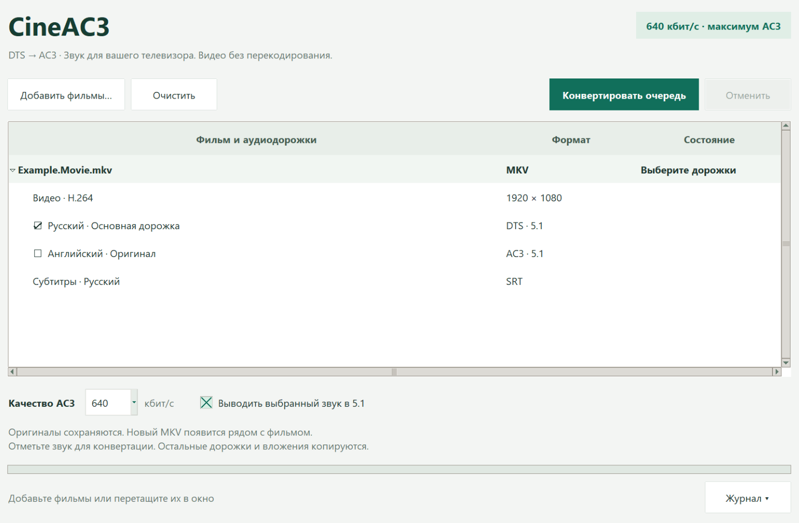

# CineAC3

**DTS → AC3. Keep the picture. Make the sound playable.**

Windows desktop app for converting selected movie audio tracks to AC3,
with a batch queue and a clean interface that scales with Windows display settings.
Designed around playback on TVs such as the LG C2.



## Возможности

- Перетащите несколько фильмов в окно или добавьте через диалог.
- Выберите дорожки для преобразования; DTS отмечается автоматически.
- AC3 до **640 кбит/с**, 48 кГц; вывод в 5.1 включён по умолчанию.
- Видео, невыбранный звук, субтитры и вложения копируются без перекодирования.
- Переносятся главы, метаданные потоков и флаги дорожек.
- Оригиналы и существующие результаты не перезаписываются.
- Очередь, прогресс, отмена, журнал ошибок и проверка результата.
- Светлый интерфейс с масштабированием Windows, прокруткой и сворачиваемым журналом.

## Запуск

1. Установите **Python 3.11+ для Windows x64** с Tcl/Tk: [python.org](https://www.python.org/downloads/windows/).
2. Скачайте исходники проекта и распакуйте их.
3. Откройте `Start.cmd` или выполните `py -3 converter.py`.

Дополнительные Python-библиотеки для запуска не нужны.
При первом запуске программа автоматически загружает FFmpeg с сайта поставщика
Windows-сборки (около 115 МБ), проверяет SHA-256 и сохраняет его в
`%LOCALAPPDATA%\CineAC3\bin`. Нужен интернет; затем можно работать офлайн.
Выбирать EXE вручную не требуется. При ошибке загрузки откройте журнал и
перезапустите приложение, чтобы повторить подготовку.

Уже установленный FFmpeg находится автоматически в `bin` рядом с программой,
в её локальном кэше либо в `PATH`. FFmpeg не включён в Git-репозиторий.

## Использование

Добавьте фильмы → отметьте нужный звук → нажмите **«Конвертировать очередь»**.
Результат появится рядом с фильмом: `Название_AC3.mkv`.
При совпадении имён добавляется номер. Файлы обрабатываются последовательно;
ошибка одного файла не мешает обработке следующих.

## Ограничения

AC3 — формат с потерями. 7.1 сводится в 5.1; преобразование стерео в 5.1
не создаёт настоящего объёмного звучания. Для сохранения числа каналов до шести
снимите галочку вывода в 5.1.

Выход всегда MKV. Неподдерживаемый поток вызывает ошибку вместо скрытого удаления.
FFmpeg не гарантирует побайтовое сохранение всех структур Matroska, в том числе
ordered chapters, связанных сегментов и сложных вложенных тегов.
Совместимость видео, HDR/Dolby Vision и субтитров с конкретным телевизором
отдельно не проверяется. CineAC3 не связан с LG, Dolby или DTS.

Перед публикацией результата проверяются число потоков/глав, кодеки, число
каналов и длительность. Это не полное декодирование и не гарантия идеального файла.

## Разработка и сборка

```powershell
py -3 -m unittest discover -v
py -3 -m pip install -r requirements.txt
py -3 -m PyInstaller --noconfirm --windowed --onedir --name CineAC3 converter.py
```

EXE находится в `dist\CineAC3`. Копируйте всю эту папку. FFmpeg будет загружен
при первом запуске; не включайте его бинарные файлы в релиз без выполнения
отдельных лицензионных требований.

## Лицензии

Код CineAC3: [MIT](LICENSE). FFmpeg и прочие компоненты имеют собственные
лицензии: [THIRD_PARTY.md](THIRD_PARTY.md).
